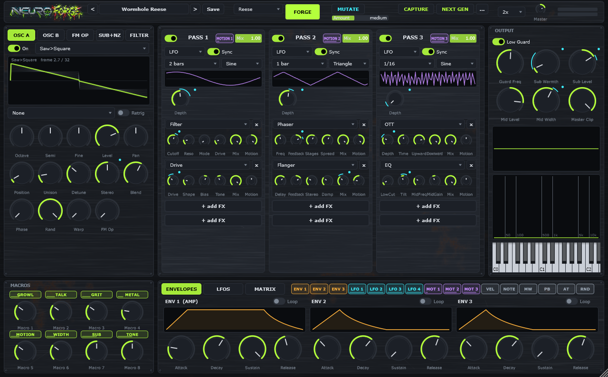

<p align="center">
  
</p>

<p align="center">
  <b>A neurofunk bass instrument.</b> Great neuro bass in seconds, and deep enough to spend hours in.<br>
  VST3 · AU · CLAP · Standalone · Windows, macOS & Linux · <b>beta</b>
</p>

<p align="center">
  <a href="https://github.com/huuba91/neuroforge/releases/tag/v0.3.0-beta"><b>⬇ Download v0.3.0-beta</b></a> ·
  <a href="docs/MANUAL.md"><b>📖 Manual & tutorials</b></a> ·
  <a href="https://github.com/huuba91/neuroforge/issues">Report a bug</a>
</p>



## What it is

Neurofunk basses (think Noisia, Phace, Ed Rush & Optical, Emperor, The Upbeats, Teddy Killerz) usually take a long chain of synths, effects and resampling passes. Neuroforge builds that workflow into one instrument:

> source → pre-filter → stacked distortion → comb / formant / phaser → OTT → **resample → do it again**

It does not dumb the process down. It lowers the entry point and raises the ceiling.

## Features

- **FORGE.** One click generates a mix-ready patch for one of 9 archetypes: Reese, FM Growl, Talker, Metallic, Tearer, Hoover, Stab, Liquid and Donk. Each click is a new variation at a consistent loudness.
- **8 macros with fixed meanings:** GROWL, TALK, GRIT, METAL, MOTION, WIDTH, SUB and TONE. They do the same job on every generated patch.
- **MUTATE** varies the current sound (subtle, medium or wild) while keeping it musical, and **UNDO** takes you back. **INIT** starts from a fresh, empty patch.
- **The Forge:** 3 passes × 4 FX slots, choosing from 14 effect types.
  - Distortion and filtering: Drive and Fold (both antialiased with ADAA), Crush, Filter, Formant and Comb.
  - Modulation effects: Phaser, Flanger, Frequency Shifter, Ring Mod and Disperser-style dispersion.
  - Dynamics and finishing: 3-band OTT, EQ and Width.
  - Each pass shows its effects as a chain of cards.
  - Each pass has its own **Motion**, a tempo-synced LFO or a 16-step sequencer. Each pass re-applies movement the way a resample pass would.
- **In-plugin resampling.**
  - **CAPTURE** renders your patch into a wavetable, sliced in sync with the note's pitch.
  - **RESAMPLE** captures your patch, loads that wavetable on OSC A and clears the Forge so you can process it again, for several generations.
- **Low Guard** keeps the sub clean and mono. An LR4 split sends the lows to a mono sub bus, and only the mids get destroyed.
- **Formats:** VST3, CLAP and a standalone app on Windows, macOS and Linux (x86_64), plus AU for Logic Pro and GarageBand. macOS builds are universal (Apple Silicon + Intel).
- **Source:** two wavetable oscillators and an FM operator.
  - 12 procedural neuro wavetables.
  - Unison up to 16 voices.
  - 11 warp modes.
- **Modulation:**
  - Looping envelopes, for Noisia-style self-moving FM.
  - 4 LFOs, 2 **curve steppers** (16 steps, a drawable curve shape and intensity per step), 24 matrix slots.
  - Drag a source chip onto any knob to modulate it. Knobs you can drop on are highlighted while you drag, and hovering a chip shows everything it modulates.
  - Sources are colour-coded: pink envelopes, cyan LFOs, purple Motion, white macros, amber steppers.
  - Each route shows as a **modulation badge** under the knob (drag it to set the depth) and a ring on the knob. When a knob has more routes than badges, **+n** opens a popover that lists every route, with a depth bar, invert and remove.
- 2x/4x internal oversampling with linear-phase decimation.
- **Workflow:** type exact values (right-click → *Enter value…*, or press Enter on a focused knob), full keyboard control of knobs, an output meter with peak hold and a latching clip light, and a scalable interface (drag the bottom-right corner).

## Install (beta)

### Windows

1. Download `Neuroforge-0.3.0-beta-win64.zip` from the [release page](https://github.com/huuba91/neuroforge/releases/tag/v0.3.0-beta).
2. Install the format your DAW uses:
   - **VST3** (Ableton Live, Cubase, FL Studio, Studio One, Reaper, …): copy the **`Neuroforge.vst3`** folder to `C:\Program Files\Common Files\VST3\`.
   - **CLAP** (Bitwig, Reaper, FL Studio, Studio One, …): copy **`Neuroforge.clap`** to `C:\Program Files\Common Files\CLAP\`.
3. Rescan plug-ins in your DAW. In Ableton: *Settings → Plug-ins → Use VST3 Plug-in System Folders → Rescan*.

`Neuroforge.exe` is a standalone version. The binaries are not code-signed yet, so Windows SmartScreen may warn on first launch.

### Linux (x86_64)

1. Download `Neuroforge-0.3.0-beta-linux-x86_64.zip` from the [release page](https://github.com/huuba91/neuroforge/releases/tag/v0.3.0-beta) once a Linux build is published there (otherwise grab the zip from the latest GitHub Actions run).
2. Unzip, then copy the formats your DAW uses:

```bash
mkdir -p ~/.vst3 ~/.clap
cp -r Neuroforge.vst3 ~/.vst3/     # VST3 (Bitwig, Reaper, Ardour, …)
cp Neuroforge.clap ~/.clap/        # CLAP (Bitwig, Reaper, …)
```

3. Rescan plug-ins in your DAW. `Neuroforge` is a standalone version you can run from anywhere.

It needs ALSA, FreeType, Fontconfig and X11 at runtime, which most desktop distributions already have. User presets are stored in `~/.config/Neuroforge/Presets`.

### macOS (10.15 or newer, Apple Silicon and Intel)

**Easiest:** paste this line into **Terminal**. It installs VST3, AU, CLAP and the standalone app for your user:

```bash
curl -fsSL https://raw.githubusercontent.com/huuba91/neuroforge/main/install-mac.sh | bash
```

Then restart your DAW. Logic Pro and GarageBand use the AU; Ableton, Bitwig, Reaper and others use the VST3 or CLAP. The script is short and [readable](install-mac.sh).

**Manual install:** download `Neuroforge-0.3.0-beta-macos.zip` and copy:

| File | Folder | DAWs |
| --- | --- | --- |
| `Neuroforge.vst3` | `~/Library/Audio/Plug-Ins/VST3/` | Ableton Live, Bitwig, Reaper, FL Studio, Cubase, … |
| `Neuroforge.component` | `~/Library/Audio/Plug-Ins/Components/` | Logic Pro, GarageBand |
| `Neuroforge.clap` | `~/Library/Audio/Plug-Ins/CLAP/` | Bitwig, Reaper, … |
| `Neuroforge.app` | `/Applications` | standalone |

> **Why the Terminal step?** These builds are not notarized by Apple (that needs a paid developer account), so macOS blocks plug-ins downloaded with a browser ("cannot be opened" or "is damaged"). The install script avoids that. After a manual install, run this once and restart your DAW:
>
> ```bash
> xattr -dr com.apple.quarantine ~/Library/Audio/Plug-Ins/*/Neuroforge.* /Applications/Neuroforge.app
> ```

### Then

Neuroforge appears as an instrument. Play around **F1–F2** and press **FORGE**.

## Learn it

The **[Manual](docs/MANUAL.md)** covers:
- a 2-minute quick start
- a signal-flow diagram
- every panel and effect
- three step-by-step tutorials: a self-moving FM growl, a talking vowel bass, and two generations of resampling

## Beta status

This is a public beta. Here is what we know:
- Tested by hand on Windows in Ableton Live (VST3) and Bitwig (CLAP).
- **Linux is CI-built and untested by hand:** the VST3, CLAP and standalone build on Ubuntu 22.04 in CI, pass the unit tests and the clap-validator, but nobody has run them in Bitwig, Reaper or Ardour on Linux yet. **Linux testers wanted!**
- **macOS is new and untested by hand:** every build passes the unit tests, Apple's `auval` Audio Unit validation and the official [clap-validator](https://github.com/free-audio/clap-validator) on a Mac in CI, but nobody has played it in Logic or Ableton on a Mac yet. **Mac testers wanted!** Please report how it runs.
- Presets are tuned for basslines around F1–F2 (about 44–87 Hz).
- Heavily clipped patches can overshoot 0 dBTP by a fraction of a dB between samples. A master limiter handles that.
- Preset and plugin-state formats may still change before 1.0.

Feedback, bug reports and sound-design ideas are very welcome in [Issues](https://github.com/huuba91/neuroforge/issues).

## Build from source

Requirements: CMake ≥ 3.22 plus Visual Studio 2022/2026 (Windows), Xcode command line tools and Ninja (macOS), or GCC/Clang, Ninja and the dev packages `libasound2-dev libx11-dev libxext-dev libxrandr-dev libxinerama-dev libxcursor-dev libfreetype6-dev libfontconfig1-dev libgl1-mesa-dev` (Linux).

```bash
git clone https://github.com/huuba91/neuroforge.git
cd neuroforge
git clone --depth 1 --branch 8.0.4 https://github.com/juce-framework/JUCE.git libs/JUCE
git clone --recursive https://github.com/free-audio/clap-juce-extensions.git libs/clap-juce-extensions
# Windows
cmake -S . -B build -G "Visual Studio 18 2026" -A x64
cmake --build build --config Release --target Neuroforge_VST3 Neuroforge_CLAP Neuroforge_Standalone
# macOS (universal binary)
cmake -S . -B build -G Ninja -DCMAKE_BUILD_TYPE=Release
cmake --build build --target Neuroforge_VST3 Neuroforge_AU Neuroforge_CLAP Neuroforge_Standalone
# Linux
cmake -S . -B build -G Ninja -DCMAKE_BUILD_TYPE=Release
cmake --build build --target Neuroforge_VST3 Neuroforge_CLAP Neuroforge_Standalone
```

Every push is also built and tested for Windows, macOS and Linux by [GitHub Actions](.github/workflows/build.yml); pushing a `v*` tag publishes a release with all zips.

`libs/clap-juce-extensions` is optional: without it, the CLAP target is simply skipped.

The output lands in `build/Neuroforge_artefacts/Release/`.

### Project layout

| Path | What |
| --- | --- |
| `src/dsp/` | Pure C++20 DSP, with no JUCE: wavetable oscillators, FX modules, crossovers |
| `src/engine/` | Voices, modulation, Forge passes, Low Guard, archetypes, Capture |
| `src/ui/`, `src/Plugin*` | JUCE plugin wrapper and interface |
| `src/tests/` | `nf_tests`: stability fuzzing, aliasing, crossover flatness, determinism, capture |
| `tools/render/` | `nf_render`: deterministic offline renders of any patch to WAV |
| `tools/analysis/` | `analyze.py`: spectrograms, LUFS, sub mono-ness, movement metrics, contact sheets |
| `tools/assets/` | Scripts that generate the logo cut-out and UI texture |
| `docs/` | [Manual](docs/MANUAL.md) and [design notes](docs/PLAN.md) |

## License

Neuroforge is released under the **GNU AGPLv3**; see [LICENSE](LICENSE). It is built with [JUCE](https://juce.com), which is used under its AGPLv3 option, and [clap-juce-extensions](https://github.com/free-audio/clap-juce-extensions) (MIT) for the CLAP format. The UI uses the Roboto Condensed font (Apache License 2.0, see [`assets/fonts/`](assets/fonts/)).
