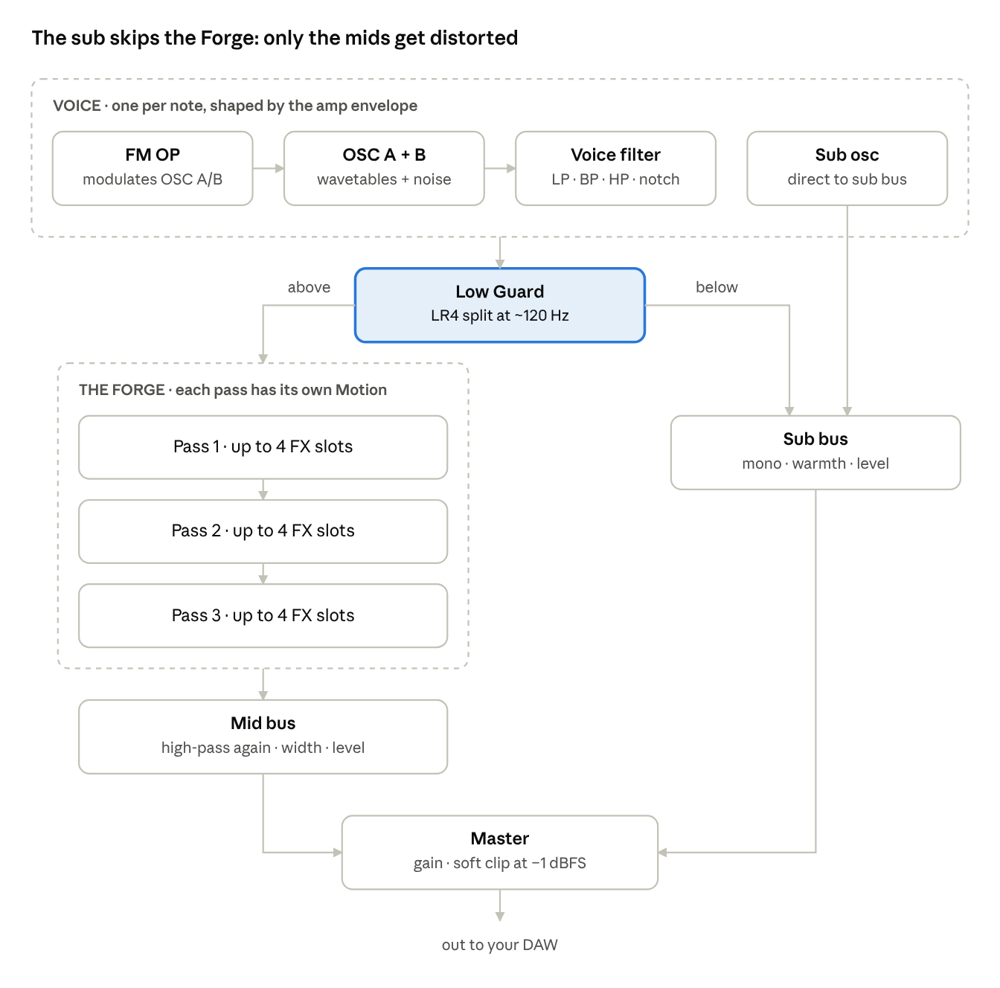

# Neuroforge Manual

Neuroforge packages the neurofunk bass workflow into one instrument: source, pre-filter, stacked distortion, comb and formant, OTT, then resample and repeat. Start with [Quick start](#quick-start). Use the later sections as a reference when you want to go deeper.

**Contents:** [Quick start](#quick-start) · [How the sound flows](#how-the-sound-flows) · [The screen](#the-screen) · [Archetypes, FORGE and Mutate](#archetypes-forge-and-mutate) · [The eight macros](#the-eight-macros) · [Source panel](#source-panel) · [The Forge](#the-forge) · [Modulation](#modulation) · [Capture and Resample](#capture-and-resample) · [Output and mixing](#output-and-mixing) · [Tutorials](#tutorials) · [Tips and troubleshooting](#tips-and-troubleshooting)

## Quick start

You can have a mix-ready neuro bass in about two minutes: pick an archetype, press FORGE, then shape it with the macros.

1. Load Neuroforge on a MIDI track. It opens on the preset **Wormhole Reese**.
2. Write a bassline around **F1–F2** (MIDI notes 29–41). Every preset is tuned for that range, and the sub follows the note you play.
3. Pick an archetype in the dropdown next to **FORGE** (for example *FM Growl*) and click **FORGE**. Each click makes a new variation at a consistent loudness.
4. Turn the eight **MACROS** (bottom left). Start with GROWL, TALK and GRIT.
5. Like it but want a sibling? Set the slider under **MUTATE** (subtle, medium or wild) and click **MUTATE**. Didn't like the result? Click **UNDO**.
6. Click **Save** to keep it. User presets appear under *User* in the preset menu. **INIT** (next to Save) starts from a fresh, empty patch.
7. Going deeper: click **RESAMPLE** to resample the sound into a wavetable and process it again. See [Capture and Resample](#capture-and-resample).

The factory presets are in the menu that opens when you click the preset name. Use the **<** and **>** arrows to step through them.

## How the sound flows

Everything below the Low Guard frequency goes to a mono sub bus. Distortion, width and every Forge effect only ever touch the mids. The two buses meet again at the master clipper.

## The screen

The window has six areas, laid out in the order the sound travels: source on the left, the Forge in the middle, output on the right.

| Area | Where | What it is for |
| --- | --- | --- |
| Top bar | Top | Three groups. Preset: preset menu, Save, INIT (fresh empty patch). Generation: archetype + FORGE, MUTATE, CAPTURE, RESAMPLE and capture settings (**...**). Utility: UNDO, quality (1x/2x/4x), Master gain and the output meter |
| Source | Left | Tabs OSC A, OSC B, FM OP, SUB+NZ and FILTER: everything that makes the raw sound, per voice |
| The Forge | Middle | Three passes, each with its own Motion and a chain of up to four effect cards |
| Output | Right | Low Guard, Sub Warmth, Sub Level, Mid Level, Mid Width, Master Clip, plus an oscilloscope, a spectrum (with dB scale) and the KEYS button that shows or hides the on-screen keyboard |
| Macros | Bottom left | Eight big knobs: GROWL, TALK, GRIT, METAL, MOTION, WIDTH, SUB, TONE |
| Modulation | Bottom | Tabs ENVELOPES, LFOS, STEPPER and MATRIX, plus the **DRAG** strip of source chips: ENV 1–3, LFO 1–4, MOT 1–3, STP 1–2, then VEL, NOTE, MW, PB, AT and RND |

Knobs work the same everywhere:

- Drag up or down to change a value. Hold **Ctrl** for fine adjustment, or use the mouse wheel.
- **Double-click** resets to the default.
- Hover or drag to see the exact value.
- The green arc is the knob's own value. Each modulation route draws a thin **ring** outside it in its source colour (pink = envelope, cyan = LFO, purple = Motion, white = macro, amber = stepper). A solid ring means positive depth, a dashed ring negative depth. A small marker shows where the knob is set and a white dot shows the live, modulated value.
- **Right-click** for: *Enter value…* (type an exact value, units optional), remove modulation, *Edit all modulation…*, reset, and *Assign to Macro*.
- **Keyboard:** click a knob, then use the arrow keys (Shift = fine), Delete to reset, Enter to type a value.
- **Modulation badges:** modulation routes show as small coloured badges under the knob (E1 = Env 1, L2 = LFO 2, MO1 = Motion 1, M3 = Macro 3, S1 = Step 1, …). **Drag a badge up or down** to set the amount, **double-click** it to remove the route, **right-click** it to invert, set +50% or remove it.
- **More routes than badges:** when a knob has more routes than fit, the last badge reads **+n**. Click it (or right-click the knob → *Edit all modulation…*) to open a popover listing every route on that knob, each with a depth bar (drag left/right, double-click for 0), **±** to invert and **×** to remove.
- **Finding routes:** hover a source chip and every knob it modulates lights up. While you drag a chip, the knobs you can drop it on show a dashed outline, and a knob flashes when a route is made.

You can resize the window from the bottom-right corner; the whole interface scales.

## Archetypes, FORGE and Mutate

FORGE builds a complete patch for the chosen archetype. That covers the source, all three passes, Motion, modulation routes, macro wiring and a loudness-matched master gain. Every click uses a new random seed, so you get a new variation within the archetype's character.

| Archetype | Character | How it is built | Factory presets |
| --- | --- | --- | --- |
| Reese | Classic dark, beating bass (Ed Rush & Optical, Phace) | Free-running detuned saw stacks; slow filter breathing; phaser + flanger smear | Wormhole Reese, Dark Matter Reese |
| FM Growl | Noisia-style rhythmic growl | Sine carrier + FM operator whose index is driven by a **looping** envelope at 1/8, 1/16 or 1/8T; fold, filter sweep, key-tracked comb | Reptile Growl, Looped Index |
| Talker | Vowel "yoi / wah" bass | Clean saw into drive, then a stepped formant sequence that spells vowels | Yoi Machine, Vowel Chop |
| Metallic | Inharmonic, clangy metal | Non-integer FM ratio, Metal Bars table, frequency shift, resonant comb, ring mod | Chrome Bars, Ring Theory |
| Tearer | Aggressive ripping (Teddy Killerz style) | Sync-saw scanned by a fast LFO, fast notch sweep into hard clip, crush, fold, heavy OTT | Rip Current, Shredder |
| Hoover | Wide hoover swoop | PWM unison 7, pitch envelope swooping up into the note, flanger | Classic Hoover |
| Stab | Short, punchy hits (Upbeats style) | Mono retrigger, snappy amp and filter envelopes, pitch snap, drive + comb | Bounce Stab |
| Liquid | Smooth, rolling | Hollow + harmonic-sweep tables, gentle filter and phaser movement | Rolling Liquid |
| Donk | Pitched "donk" ping | Triangle with a fast pitch drop of 19–31 semitones, FM bite, fold | Donk Ping |

**MUTATE** nudges the current patch instead of starting over. The slider sets how far:

- **subtle**: small jitter on knob values. Good for making a variation of a sound you like.
- **medium**: larger moves; LFO and Motion rates, wavetables and FM ratios may change.
- **wild**: may also swap "character" effects (comb, phaser, flanger, disperse, frequency shift, ring mod, formant, fold) for siblings.

Mutate never touches the master section, Low Guard, the sub, oscillator levels, the amp envelope, macros or modulation routes. It re-matches loudness afterwards.

**UNDO** (in the utility group of the top bar) steps back through your last whole-patch changes: FORGE, MUTATE, RESAMPLE, loading a preset and Init. It remembers up to 32 steps. Knob tweaks are not part of this history; use your DAW's undo for those.

## The eight macros

Every generated patch wires the macros to the same jobs, so GROWL always means "more growl" whichever archetype you are on. Generated patches leave the macros around 0.30–0.50, so you can turn them both ways.

| Macro | What it does | Typical targets |
| --- | --- | --- |
| GROWL | The main timbre mover | FM index and feedback, filter cutoff, fold drive, formant sharpness, pitch envelope (depends on archetype) |
| TALK | How much the sound speaks | Depth of the talking pass's Motion; on Talker also the formant shift |
| GRIT | Dirt and density | Drive amount of the main distortion slot and OTT depth |
| METAL | Metallic resonance | Mix of the comb / ring / flanger slot, comb feedback |
| MOTION | Overall movement | Motion depth of all three passes |
| WIDTH | Stereo size of the mids | Mid Width and Osc A unison stereo (the sub always stays mono) |
| SUB | Sub weight | Sub level and sub warmth |
| TONE | Brightness | Tilt of the final EQ |

Macros are ordinary modulation sources, and you can assign anything to them. Right-click a knob and choose *Assign to Macro*, or drag a macro's label chip onto a knob. The routes they drive are listed in the MATRIX tab.

## Source panel

The Source panel makes the raw sound for each voice. It has two wavetable oscillators, an FM operator, a sub, noise, a voice filter and a pitch envelope.

### OSC A and OSC B

| Control | Range | Use it for |
| --- | --- | --- |
| Table | 12 built-in tables + Capture 1–4 | The waveform family; the display shows the current frame |
| Position | 0.00–1.00 | Scans through the table's frames; modulate it for movement |
| Octave / Semi / Fine | ±3 oct / ±12 st / ±100 ct | Tuning |
| Level / Pan | 0.00–1.00 / −1.00 to +1.00 (L–R) | Mix and placement |
| Unison | 1–16 voices | Thickness |
| Detune | 0.00–1.00 (total spread) | Beating; the curve is gentle near the centre voice |
| Stereo / Blend | 0.00–1.00 | Unison width / centre voice versus side voices |
| Phase / Rand | 0.00–1.00 | Start phase and how random it is per note |
| Warp + Warp amount | 11 modes | Reshapes the waveform (see below) |
| FM Op | 0.00–1.00 | How much the FM operator modulates this oscillator |
| Retrig | On / Off | Restart the phase on every note |

**Punch or beating?** Retrig on with Rand at 0.00 gives identical, punchy hits. Retrig off with Rand at 1.00 lets the oscillators run free, which is what makes a classic Reese beat and move by itself.

**Wavetables:** Saw>Square, Basic Shapes (sine, triangle, saw, square), PWM, Formant Vox (vowels across the table), Harmonic Sweep, Metal Bars, Reese Pulse, Growl FM, Sync Saw, Digital Grit, Hollow, Phase Dist (Casio CZ-style, where the original Reese came from). Capture 1–4 hold your own resamples.

**Warp modes:** Sync, Bend+, Bend−, PWM, Mirror, Asym, Quantize (digital steps), Phase Dist, FM from B and Ring from B. The last two let OSC B modulate OSC A, so set them on OSC A with OSC B switched on.

### FM OP

A sine-family modulator that drives the **FM Op** knob of each oscillator.

- **Ratio** (0.25–16): 1 and 2 give saw- and square-like growls; 3, 5 and 7 get brighter and more metallic; 0.5 adds sub-harmonic weight.
- **Fine** (±100 cents): a few cents off an integer ratio makes the harmonics beat, so the bass moves without an LFO.
- **Feedback** goes from rasp to noise. **Shape** offers sine, triangle, saw and square.
- The classic Noisia move:
  1. Turn FM OP on.
  2. Switch **Loop** on for Env 3 (ENVELOPES tab).
  3. Drag the ENV 3 chip onto OSC A's FM Op knob.

  The FM index now pulses on its own.

### SUB+NZ

- **Sub**: On, Octave (−2 to 0), Shape (sine, triangle, square, saw), Level.
- **Direct** (on by default) sends the sub straight to the mono sub bus, so no FX ever touch it. Turn it off only if you want the sub inside the Forge.
- **Noise**: Level and Color (dark to bright). Useful for air and grit layers.

### FILTER

- **Voice Filter**: On, Mode (morphs low-pass, band-pass, high-pass, notch), Cutoff, Reso, Drive, Keytrack. **Env** sets how much Env 2 opens or closes the cutoff (±).
- **Pitch / Voice**: Pitch Env (±48 semitones, from Env 2 or Env 3), Glide, voice mode (Poly, Mono, Legato), Bend range and Velocity sensitivity.
- Legato plus Glide gives sliding neuro basslines. Mono retriggers envelopes on every note, which suits stabs.

## The Forge

The Forge is where a neuro bass gets its character. It is three passes in series, each with up to four FX slots and its own **Motion**. Think of each pass as one round of "resample, process, add new movement", without bouncing audio.

### Passes

- The toggle in the pass header switches a pass on or off; an active pass has a lit top edge and a bypassed pass is dimmed. **Mix** blends the pass with its input, so a pass can run as parallel processing.
- A typical split:
  - **Pass 1** shapes and talks (filter or formant, then drive).
  - **Pass 2** adds character (comb, phaser, fold, crush).
  - **Pass 3** finishes (OTT, EQ, width).

### Motion

Each pass has one Motion modulator that moves the **first knob (P1)** of every slot in that pass.

- **LFO** mode: with Sync on, pick a division (8 bars down to 1/64, with dotted and triplet values). With Sync off, pick a rate in Hz. Shapes: Sine, Triangle, Saw Up, Saw Down, Square, S&H, Smooth Rand.
- **Steps** mode: draw up to 16 bars with the mouse, then set the number of Steps and the Glide between them. With Sync on, the division sets the length of the whole pattern (8 steps in 1 bar = one step per 1/8 note). The cyan column shows the current step.
- **Depth** sets how far Motion moves. At Depth 1.00 and slot Motion +100%, P1 swings ±50% of its range around where you set the knob.
- With Sync on and your DAW playing, Motion locks to the song position. When the transport is stopped it restarts on every note.
- Give each pass a different rate (for example 1/8, 1/4T and 1/16). The rhythms rub against each other and the bass never sounds static.

### FX slots

Each pass shows its effects as a chain of cards under **EFFECTS**, in processing order (scroll the chain if it doesn't fit). Click an empty **+ Add effect** slot to pick an effect, click a card's title to swap it for another, and **×** removes it. Every card has its four parameters, plus **Mix** and **Motion** in its footer. Motion runs from −100% to +100% and sets how strongly, and in which direction, the pass's Motion moves P1.

| FX | P1 (Motion target) | P2 | P3 | P4 | Good for |
| --- | --- | --- | --- | --- | --- |
| Drive | Drive (0–36 dB) | Shape (soft to hard clip) | Bias (asymmetry) | Tone | The main grit; Bias adds even harmonics |
| Fold | Drive (0–30 dB) | Folds | Bias | Tone | Wavefolding growl; automate Drive for yowls |
| Crush | Rate (200 Hz–48 kHz) | Bits (1–16) | Jitter | Tone | Digital grain and aliasing |
| Filter | Cutoff | Reso | Mode (LP, BP, HP, Notch) | Drive | Sweeps; a moving notch alone gives lots of movement |
| Formant | Vowel (A, E, I, O, U) | Shift (±12 st) | Q | Spread (L/R vowel offset) | Talking basses |
| Comb | Freq | Feedback (±) | Damp | KeyTrack | Metallic resonance; with KeyTrack on, Freq 100 Hz = tuned to the note, 200 Hz = an octave up, 300 Hz = a fifth above that |
| Phaser | Freq | Feedback | Stages (2–12) | Spread | Classic reese smear |
| Flanger | Delay (0.05–15 ms) | Feedback (±) | Stereo | Damp | Jet sweeps and hollow tones |
| FreqShift | Shift (±1000 Hz) | Feedback | Stereo | – | Inharmonic sheen; small shifts give slow beating |
| RingMod | Freq | KeyTrack | Shape (sine to square) | – | Bell-like metal |
| Disperse | Freq | Amount (up to 64 allpass stages) | Pinch | Spread | Laser "zap" smear (Disperser style) |
| OTT | Depth | Time | Up (upward) | Down (downward) | Three-band upward and downward compression: brings up grit and detail |
| EQ | Low Cut | Tilt (±12 dB) | Mid Freq | Mid Gain | Clean-up and tone |
| Width | Width (0.00–2.00) | Haas (0–20 ms) | Mono below | – | Stereo shaping |

**Order matters.**
- A filter, notch or formant *before* distortion changes which harmonics get distorted, so the sound talks.
- The same filter *after* distortion only shapes what is already there.
- Stack gentle distortion first and harder distortion later.
- Put OTT after distortion and follow it with an EQ to tame what it brings up.

## Modulation

Anything with a knob can move. The quickest way is to **drag a source chip onto a knob**. This creates a route at 50% in the first free matrix row.

- **Source chips** sit in three places:
  - the **DRAG** strip next to the modulation tabs (ENV 1–3, LFO 1–4, MOT 1–3, STP 1–2, VEL, NOTE, MW, PB, AT, RND)
  - above each macro knob
  - as the MOTION chip in each pass header
- **Change the amount**: drag the route's badge under the knob, Alt-drag the knob, click **+n** for the full list, or edit the row in the MATRIX tab.
- **Remove**: double-click the badge, right-click the knob and choose *Remove modulation from …*, or clear the row in MATRIX.

| Source | Range | Notes |
| --- | --- | --- |
| ENV 1 | 0 to 1 | The amp envelope |
| ENV 2, ENV 3 | 0 to 1 | Free envelopes; **Loop** repeats attack + decay while the note is held. Env 2 also drives the voice filter's Env knob; either can drive Pitch Env |
| LFO 1–4 | −1 to +1 | Sync or Hz rate, 7 shapes, Retrig (restart per note) and Phase |
| MOT 1–3 | −1 to +1 | The three pass Motions, usable anywhere |
| Macro 1–8 | 0 to 1 | The eight macro knobs |
| VEL, NOTE | per note | Velocity and keyboard position |
| MW, PB, AT | controller | Mod wheel, pitch bend, aftertouch |
| RND | per note | A new random value on every note |
| STP 1, STP 2 | 0 to 1 | The two curve steppers (see below) |

### Curve stepper

The **STEPPER** tab holds two curve sequencers, STEP 1 and STEP 2, in the style of Massive's Performer. Each has up to 16 steps, and every step plays a **curve shape** at its own **intensity**.

- **Pick a curve:** drag one of the 20 shapes from the palette (ramps, exp/log, hump, pulse, spike, bounce, trill, stairs, wobble, …) onto a step. Or select a step, then click a curve. The mouse wheel on a step cycles its curve; right-click picks one from a list.
- **Set intensity:** drag up or down inside a step. Drag sideways to paint several steps at once. Double-click a step for full intensity.
- The **Timing** group holds Sync, Retrig and the step length or Rate; the **Pattern** group holds Steps and Smooth. Switch between the two sequencers with the **STEP 1 / STEP 2** pills.
- **Steps** sets the pattern length, the **step length** (Sync on, e.g. 1/16) or **Rate** (Sync off, Hz) sets the speed, **Smooth** rounds off jumps between steps, and **Retrig** restarts the pattern on each note.
- Drag the **STP 1 / STP 2** chip onto any knob to use it. A stepper on a filter cutoff, formant vowel or FM amount gives detailed, rhythmic talking that an LFO can't.

**Looping envelopes** are the secret to self-moving FM basses. A looped Env 3 with Attack 40.0 ms and Decay 130 ms repeats about every 1/8 note at 174 BPM. Route it to an FM Op amount, a wavetable Position or a filter cutoff.

The **MATRIX** tab shows all 24 routes: a colour-coded source, a destination named by section and slot (for example *Filter Cutoff (Slot 1)*), and a bipolar amount. Modulation adds to the knob's own value, so set the knob where the movement should start.

## Capture and Resample

Capture is resampling inside the plugin. It renders your current patch holding one note, then cuts the result into a wavetable you can play and process again.

**How it works:**
- Neuroforge renders the note in the background for the set number of beats. All Motion and LFOs run at your project tempo during the render.
- It knows the note's exact pitch, so it slices the render into single-cycle frames spread evenly across the whole render. Frame 1 is the start of the note and the last frame is the end.
- Scanning **Position** therefore travels through the *time* of the old patch: its filter sweeps, vowels and FM pulses become positions in the table.
- The sub is left out of the capture; your live sub keeps doing that job.

| Button | What it does |
| --- | --- |
| CAPTURE | Renders into the next capture slot (Capture 1–4, cycling) and leaves your patch as it is. Pick the capture in any oscillator's Table menu |
| RESAMPLE | Captures the current patch, loads it on OSC A and clears the Forge for the next round. OSC B, FM OP, noise, the voice filter and pitch envelope are reset; the sub, envelopes, output settings and macros stay |
| ... | Capture settings: **Note** (C1–C5, default C2), **Beats** (1–16, default 4) and **Frames** (16–256, default 128) |

The status next to the buttons shows *Rendering…* and then which slot was filled. Captures are saved in the plugin state, so they are stored with your DAW project.

**Tips**

- Capture at the pitch you will play (or an octave above) for the most natural result. Playing far from the capture note shifts its formants, which can be a great effect in itself.
- Fewer frames with more beats gives coarser, steppier scanning; 128–256 frames gives smooth morphs.
- Captures of captures work: a RESAMPLE patch can be captured again, three or four generations deep. Each generation adds a layer of movement that is now baked into the waveform.
- After RESAMPLE, the first move is usually to put an LFO, a looping envelope or a Motion on OSC A **Position**. Then rebuild a pass or two around it.

## Output and mixing

Neuroforge keeps the sub clean and mono automatically, so you can distort the mids as hard as you like.

The output meter in the top bar shows the level in dB with a peak hold of about 1.5 seconds. The **CLIP** light stays on once the output reaches 0 dBFS; click it to reset.

| Control | What it does | Starting point |
| --- | --- | --- |
| Low Guard | Splits the oscillators at Guard Freq. Everything below goes to the mono sub bus; everything above goes through the Forge, and is high-passed again afterwards so distortion cannot muddy the low end | On |
| Guard Freq | Split frequency (40–300 Hz) | 105–140 Hz |
| Sub Warmth | Gentle saturation on the sub bus, low-passed so it stays round; helps the sub translate on small speakers | 0.10–0.25 |
| Sub Level | Level of the sub bus (−36 to +6 dB) | −6.0 dB |
| Mid Level | Level of the processed mids (−36 to +6 dB) | 0.0 to +2.0 dB |
| Mid Width | Stereo width of the mids only (0.00–2.00) | 1.00–1.30 |
| Master Clip | Soft ceiling at −1 dBFS; the amount sets how hard it clips | 1.00 on generated patches |
| Master | Output gain before the clipper | Set by FORGE |
| Quality (top bar) | Internal oversampling: 1x, 2x or 4x | 2x |

**In the mix:**

- Generated patches land around −10 dBFS RMS with peaks just under −1 dBFS, so they sit at a similar level when you flip between them.
- Heavily clipped bass can still overshoot 0 dB *between* samples by a fraction of a dB. A limiter on your master handles that.
- Sidechain the bass to the kick as usual, for example with your DAW's compressor fed by the kick. 2–6 dB of gain reduction is typical.
- **Quality**: 2x is clean for almost everything. Use 4x for extreme FM, sync or folding at high notes, and 1x to save CPU while sketching. One note at 2x uses roughly 4–7% of one CPU core.

## Tutorials

Three recipes, each about ten minutes. Play a held F1 while you build, then a bassline.

### 1. Self-moving FM growl (Noisia-style)

1. Click **INIT** (top bar, next to Save). On SUB+NZ set the sub **Octave** to 0.
2. OSC A: **Table** Basic Shapes, **Position** 0.00 (a sine).
3. FM OP: **On**, **Ratio** 1, **Fine** 5 ct, **Feedback** 0.20. Back on OSC A, set **FM Op** to 0.25.
4. ENVELOPES → Env 3: Attack 40.0 ms, Decay 130 ms, Sustain 0.00, **Loop** on.
5. Drag the **ENV 3** chip onto OSC A's **FM Op** knob. Drag the **E3** badge under the knob upward until the pink ring reaches about 70% (or Alt-drag the knob). The growl now pulses on 1/8 notes by itself.
6. Pass 1: add **Fold** (Drive 10.0 dB, Folds 0.40), then **Filter** (Cutoff 4.00 kHz, Reso 0.35).
   - Set Motion to Sync, 1/8, Saw Down, Depth 0.50.
   - Set the Fold slot's Motion to 0% so only the filter moves.
7. Pass 2: **Comb** (KeyTrack on, Freq 200 Hz, Feedback 0.60, Mix 35%) then **Drive** (8.0 dB, Shape 0.80).
8. Pass 3: **OTT** (Depth 0.50) then **EQ** (Mid freq 350 Hz, Mid gain −3.0 dB).
9. Output: Sub Level −6.0 dB. Try FM OP Ratio 2 or 0.5 for different growls.

**Listen:** [tutorial-1.mp3](audio/tutorial-1.mp3)

### 2. Talking bass with a vowel sequence

1. Pick **Talker** and press FORGE, or start from Init with OSC A on Saw>Square, Unison 1.
2. Pass 1, slot 1: **Drive** (12.0 dB) with its Motion at 0%. Slot 2: **Formant** (Vowel 2.00 (I), Q 0.65, Mix 100%, Motion 100%).
3. Motion 1: mode **Steps**, Sync, 1 bar, Depth 1.00, Steps 8, Glide 0.40. In Steps mode the division is the length of the whole pattern, so 8 steps in 1 bar gives one vowel per 1/8 note. Try 1/8 for a very fast vowel chatter.
4. Draw the bars: bottom = A, a quarter of the way up = E, halfway = I, three quarters = O, top = U. Try A, O, I, E, A, U, I, O.
5. Drive *before* the formant gives hard, clear talking; swap the slots for a smoother, rounder voice.
6. Turn **GROWL** for a sharper formant and **TALK** to push the vowel movement.

**Listen:** [tutorial-2.mp3](audio/tutorial-2.mp3)

### 3. Two generations of resampling

1. Load **Wormhole Reese**. In **...** set Note F1, Beats 8, Frames 256.
2. Click **RESAMPLE**. OSC A now plays Capture 1 and the Forge is empty.
3. LFOS → LFO 1: Sync, 1/4, Triangle. Drag the **LFO 1** chip onto OSC A **Position**. The old patch's filter sweeps now play back on 1/4 notes.
4. Pass 1: **Comb** (KeyTrack, Freq 300 Hz, Feedback 0.75) then **Drive** (10.0 dB). Motion 1/8T, Depth 0.30.
5. Pass 3: **OTT** (Depth 0.45) then **EQ**.
6. Click **RESAMPLE** again for a third generation. Drag the **LFO 1** chip onto OSC A **Position** again so the new table moves, then give it a new movement, for example a Formant step sequence in Pass 2.
7. Click **MUTATE** (subtle) a few times and **Save** the versions you like. That is your bass library for the track.

**Listen:** [tutorial-3.mp3](audio/tutorial-3.mp3)

## Tips and troubleshooting

| Problem | Fix |
| --- | --- |
| The low end sounds thin or rumbles at very low pitch | Check the sub **Octave** on SUB+NZ: use 0 when you play around F1, −1 when you play around F2–F3 |
| A pass makes the bass go quiet or hollow | A Formant or Comb at 100% Mix removes a lot of energy; lower its Mix or raise Mid Level |
| Everything sounds like noise | Too much stacked distortion plus OTT on a detuned source. Use Unison 1 for talking sounds, lower GRIT, or switch off a pass to find the culprit |
| Motion moves the wrong knob | Motion always moves P1 of every slot in its pass. Set the slot's **Motion** knob to 0% on slots that should stay still |
| Motion is out of time | With Sync on it follows your project tempo; it locks to the bar only while your DAW is playing |
| FORGE or MUTATE changed my levels | FORGE re-matches loudness; turn **Master** to taste afterwards |
| CAPTURE seems to do nothing | Check the status text, then pick Capture 1–4 in an oscillator's Table menu. RESAMPLE does that for you |
| High CPU | Lower Quality to 1x while writing, use fewer unison voices, and keep Disperse Amount moderate (it is the heaviest effect) |

More ideas:

- Automate the macros in your DAW for drops and fills; every macro is a normal automatable parameter.
- Use **RND** (random per note) on Formant Vowel or Comb Freq for subtle per-hit variation, a hallmark of modern neuro.
- Stack two Neuroforge instances with the same patch but different Motion rates, and switch the sub off on one of them. That gives a huge, evolving bass.
- Your user presets live in `%APPDATA%\Neuroforge\Presets` (Windows) or `~/Library/Application Support/Neuroforge/Presets` (macOS) as `.nfpreset` text files, easy to back up or share.
